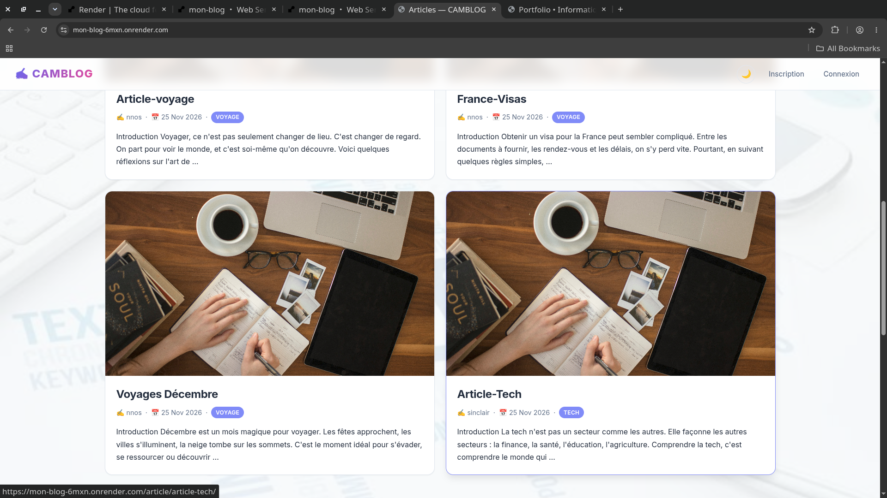
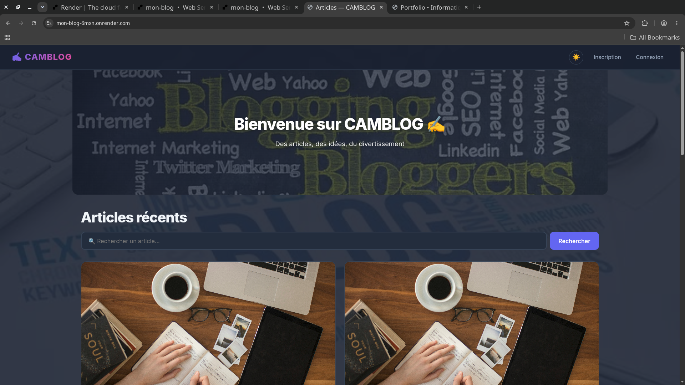
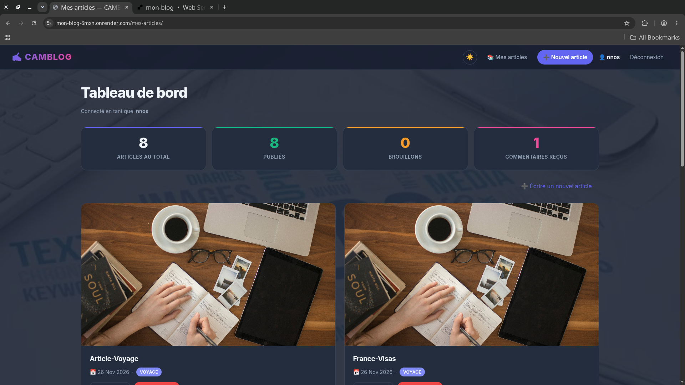

<div align="center">

# ✍️ CAMBLOG

### Un espace pour penser, écrire et partager.

[](https://www.djangoproject.com/)
[](https://www.python.org/)
[](https://www.postgresql.org/)
[](https://render.com/)
[](https://opensource.org/licenses/MIT)

[](https://mon-blog-6mxn.onrender.com/)

</div>

---

## 📖 À propos

**CAMBLOG** est un blog moderne et complet développé avec **Django**. Il permet à plusieurs utilisateurs de s'inscrire, de publier des articles, de les organiser par catégories, et d'interagir via un système de commentaires.

Ce projet a été conçu comme un **projet d'apprentissage complet** couvrant l'ensemble du cycle de développement d'une application web : de la modélisation des données au déploiement en production.

---

## ✨ Fonctionnalités

### 👤 Authentification & Utilisateurs
- ✅ Inscription publique
- ✅ Connexion / Déconnexion
- ✅ Tableau de bord personnel ("Mes articles")
- ✅ Chaque utilisateur ne peut modifier/supprimer **que ses propres articles**

### 📝 Articles
- ✅ CRUD complet (Créer, Lire, Modifier, Supprimer)
- ✅ Catégories (création depuis le formulaire d'article)
- ✅ Image de couverture (avec image par défaut)
- ✅ Brouillons / Publications
- ✅ Slug auto-généré à partir du titre

### 💬 Interactions
- ✅ Commentaires avec validation d'email
- ✅ Recherche full-text (titre, contenu, auteur, catégorie)
- ✅ Pagination

### 🎨 Interface
- ✅ Design system avec variables CSS
- ✅ Mode sombre / clair (persistant via `localStorage`)
- ✅ Responsive (mobile-first)
- ✅ Animations au scroll (`IntersectionObserver`)
- ✅ Hero avec image de fond animée
- ✅ Grille de cartes 2 colonnes

### 🔍 SEO & Accessibilité
- ✅ Meta tags (description, author)
- ✅ Open Graph (Facebook, LinkedIn)
- ✅ Twitter Cards
- ✅ `robots.txt`
- ✅ Page 404 personnalisée

---

## 🛠️ Stack technique

| Catégorie | Technologie |
|---|---|
| **Backend** | Django 6.1.3, Python 3.13 |
| **Base de données** | SQLite (dev), PostgreSQL (prod) |
| **Frontend** | HTML5, CSS3, JavaScript (vanilla) |
| **Serveur** | Gunicorn |
| **Fichiers statiques** | WhiteNoise |
| **Déploiement** | Render |
| **Versioning** | Git + GitHub |

---

## 🚀 Installation en local

### Prérequis
- Python 3.13+
- Git
- Un terminal

### Étapes

```bash
# 1. Cloner le repo
git clone https://github.com/Nnos5/mon-blog.git
cd mon-blog

# 2. Créer et activer un environnement virtuel
python -m venv venv
source venv/bin/activate        # Linux/macOS
# ou
venv\Scripts\activate           # Windows

# 3. Installer les dépendances
pip install -r requirements.txt

# 4. Appliquer les migrations
python manage.py migrate

# 5. Créer un superutilisateur
python manage.py createsuperuser

# 6. Lancer le serveur
python manage.py runserver
Le site sera accessible sur http://127.0.0.1:8000/ ✅

📁 Structure du projet
text
mon-blog/
├── manage.py
├── requirements.txt
├── build.sh                    # Script de build pour Render
├── render.yaml                 # Config de déploiement Render
├── .gitignore
├── LICENSE
│
├── monblog/                    # Configuration Django
│   ├── settings.py
│   ├── urls.py
│   └── wsgi.py
│
├── blog/                       # Application principale
│   ├── models.py               # Article, Categorie, Commentaire
│   ├── views.py                # Vues (fonctions + classes)
│   ├── forms.py                # Formulaires
│   ├── admin.py                # Admin Django
│   ├── urls.py
│   ├── sitemaps.py
│   │
│   ├── migrations/
│   │
│   └── templates/
│       ├── blog/
│       │   ├── base.html
│       │   ├── article_list.html
│       │   ├── article_detail.html
│       │   ├── article_form.html
│       │   ├── article_confirm_delete.html
│       │   └── my_articles.html
│       ├── registration/
│       │   ├── login.html
│       │   └── signup.html
│       ├── 404.html
│       └── robots.txt
│
├── static/                     # Fichiers statiques
│   ├── css/
│   │   └── style.css
│   └── images/
│       ├── article.jpg
│       ├── hero.jpg
│       └── background.jpg
│
└── media/                      # Uploads utilisateurs
    └── articles/
🗄️ Modèles de données
Categorie
Champ	Type	Description
nom	CharField	Nom unique de la catégorie
slug	SlugField	Version URL-friendly
Article
Champ	Type	Description
titre	CharField	Titre de l'article
slug	SlugField	URL unique
contenu	TextField	Contenu complet
image	ImageField	Image de couverture (optionnelle)
auteur	ForeignKey(User)	Auteur de l'article
categorie	ForeignKey(Categorie)	Catégorie (optionnelle)
date_publication	DateTimeField	Date de publication
publie	BooleanField	Publié ou brouillon
Commentaire
Champ	Type	Description
article	ForeignKey(Article)	Article commenté
nom	CharField	Nom du commentateur
email	EmailField	Email validé
contenu	TextField	Contenu du commentaire
date_creation	DateTimeField	Date du commentaire
approuve	BooleanField	Modération
🌐 Déploiement sur Render
Le projet est configuré pour un déploiement automatique sur Render.

Variables d'environnement à configurer
Clé	Description
SECRET_KEY	Clé secrète Django (générée)
DEBUG	False en production
ALLOWED_HOSTS	Domaine(s) autorisé(s)
DATABASE_URL	URL PostgreSQL (fournie par Render)
Commandes de déploiement
Render exécute automatiquement build.sh :

bash
pip install -r requirements.txt
python manage.py collectstatic --no-input
python manage.py migrate
Puis lance :

bash
gunicorn monblog.wsgi:application
🧪 Tester le projet
bash
# Vérifier la configuration
python manage.py check

# Lancer les tests
python manage.py test

# Accéder à l'admin
http://127.0.0.1:8000/admin/

## 📸 Captures d'écran

### Page d'accueil (mode clair)


### Mode sombre


### Tableau de bord
